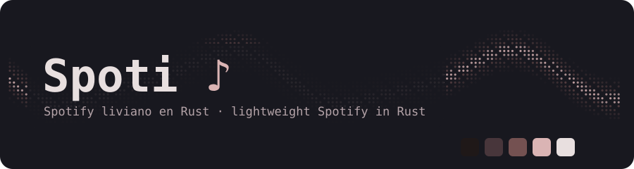
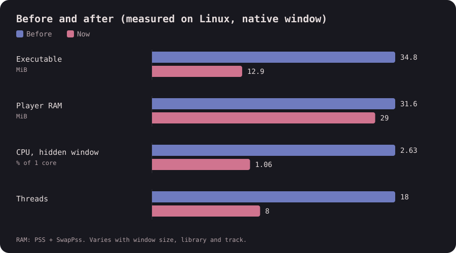

<div align="center">

**English** | [Español](README.md)



**A lightweight Spotify, YouTube and SoundCloud client in Rust with synced lyrics and an animated background.**


</div>

## What it is

Spoti is a lightweight Spotify client written in Rust. It started as a fork of [ncspot](https://github.com/hrkfdn/ncspot) 1.5.1 and plays audio through [librespot](https://github.com/librespot-org/librespot). Spotify needs a **Premium** account; YouTube and SoundCloud work without an account, so you can also use Spoti without Spotify.

## Features

- 🪟 **Native Wayland window**, drawn with Cairo and shared memory: no terminal, no GTK.
- ▶️ **YouTube and SoundCloud** (optional, no account): search and play from all three services in the same list and the same queue. See [YouTube and SoundCloud](#youtube-and-soundcloud).
- 🎤 **Synced lyrics** from [LRCLIB](https://lrclib.net), toggled with `Shift+L`. In narrow windows it opens a full-screen lyrics panel.
- 🌌 **Animated Unicode braille background** (toggle with `v`).
- 🎨 **Athena palette**, read live from the `[theme]` section of ncspot's `config.toml`.
- 🖱️ **Focus follows the mouse** between panels; clickable controls and progress bar.
- 💻 **X11 or terminal**: the same panels inside a terminal with `ncspot --panels`.
- 🪟 **Windows**: runs in Windows Terminal with the same lyrics and background panels (no native window there; hover-focus may not work in terminals, click does).
- 🧩 Optional **Athena popover** for Hyprland (`spoti-popover`, wlr-layer-shell).

## Metrics

<div align="center">

</div>

| Measurement | Before | Now |
|---|---|---|
| Executable | 34.8 MiB | 12.9 MiB |
| Player RAM (PSS+SwapPss) | ~31.6 MiB | ~29 MiB (+3–4 MiB with the Athena popover) |
| CPU, window hidden | 2.63% of one core | 1.06% |
| Threads | 18 | 8 |
| Allocations per lyrics frame | 62 | 0 |

Playing: ~0.7% of one core. Paused: ~0.15%. **320 kbps** bitrate and **gapless** playback are kept.

> Measured on a single Linux machine with the native window. Windows was not measured. Values vary with window size, library and track.

## Download and install

Spotify needs **Premium**; YouTube and SoundCloud need no account. Every version is on [Releases](https://github.com/nicolaschiabrandozanotti/Spotan/releases).

### Linux (x86_64) — one command

```sh
curl -fsSL https://github.com/nicolaschiabrandozanotti/Spotan/releases/latest/download/spoti-linux-x86_64.tar.gz | tar xz && ./spoti-linux-x86_64/install.sh
```

Then open it with `spoti` or from your app menu. It installs per user, **no sudo**: everything goes to `~/.local`, plus a desktop entry and the JetBrains Mono Nerd Font. Tested on Ubuntu 22.04/24.04, Debian 12, Fedora and Arch (glibc ≥ 2.34). It only needs PulseAudio or PipeWire, cairo and xkbcommon, which ship with any desktop. To uninstall: `./spoti-linux-x86_64/uninstall.sh`.

### Windows 10/11 (x64) — one PowerShell command

```powershell
irm https://github.com/nicolaschiabrandozanotti/Spotan/releases/latest/download/spoti-windows-x86_64.zip -OutFile "$env:TEMP\spoti.zip"; Expand-Archive "$env:TEMP\spoti.zip" "$env:LOCALAPPDATA\Spoti" -Force; & "$env:LOCALAPPDATA\Spoti\spoti-windows-x86_64\spoti.bat"
```

To open it again: `%LOCALAPPDATA%\Spoti\spoti-windows-x86_64\spoti.bat`. You can also download the `.zip` from Releases, unzip it and double-click `spoti.bat`; SmartScreen may warn because the executable is unsigned (*More info → Run anyway*). On first run it copies the theme to `%APPDATA%\ncspot\config.toml` without overwriting an existing config and opens Windows Terminal if available.

On first run Spoti opens a start screen with a **Iniciar sesión con Spotify** (log in) button: your browser opens, you accept and come back to Spoti, which loads your music and library. The session is saved.

## YouTube and SoundCloud

They are **off** by default. To use them:

1. Open **Settings** (`F4`) and tick **YouTube** and/or **SoundCloud** under *Other services* (the labels are in Spanish: *Otros servicios*). It is saved right away, no restart.
2. Go to **Search** as usual. Each track shows where it comes from: `[S]` Spotify, `[YT]` YouTube, `[SC]` SoundCloud.
3. With two or more services on, the **`[1 Spotify] [2 YouTube] [3 SoundCloud]`** bar shows above the results: keys `1`, `2` and `3` (or a click) show or hide each service.
4. Play, seek, pause and mix services in the queue: it moves on to the next track by itself.

Without Spotify: on the start screen tick YouTube and/or SoundCloud and press **Entrar sin Spotify** (*Enter without Spotify*); you can log in to Spotify later from Settings.

### Your SoundCloud library

With SoundCloud ticked, in **Settings** (`F4`), under *Other services*, paste your profile link into **Perfil:** (`Ctrl+V` or right-click) and press **Cargar** (Load). A summary shows below, e.g. `Forss · 288 Likes · 4 playlists`. **Quitar** (Remove) clears it.

- It loads your *Likes*, your playlists and the playlists you saved, all public and with no login. Private items are not visible.
- In **Library** (`F3`), the *Temas* (Tracks), *Listas* (Lists) and *Álbumes* (Albums) tabs mix Spotify and SoundCloud (`[S]` / `[SC]`), with a `[1 Spotify] [2 SoundCloud]` filter bar (keys `1` and `2`). SoundCloud albums and EPs go in *Albums* (not in *Lists*) and open and play like any album; without Spotify, that tab shows the SoundCloud ones.
- It refreshes when Spoti starts and with `Shift+U`. It also works without Spotify (*Entrar sin Spotify* + profile).
- It is **read-only**: you can't delete or like anything from SoundCloud in Spoti (`SoundCloud: solo lectura`).

### Your YouTube library

With YouTube ticked, in **Settings** (`F4`), under *Other services*, paste a link into **Links** (`Ctrl+V` or right-click) and press **Agregar** (Add). Each link has its own **Quitar** (Remove).

- Public YouTube and YouTube Music playlist or channel links work: `youtube.com/playlist?list=…`, `music.youtube.com/playlist?list=…`, `youtube.com/@handle` and `youtube.com/channel/UC…`. No login needed.
- **Session (optional):** in the same section, under the links, the **Sesión** (Session) line shows the status (no session / connected). **Tomar de Firefox** (Take from Firefox) asks permission first (*Permitir y renovar sola* = allow and renew automatically, *Solo esta vez* = just this once, or *Cancelar*) and reads only the YouTube session cookies (Linux and Windows, including Flatpak/Snap Firefox). **Pegar** (Paste) is for other browsers (Chrome/Brave/Edge): on `music.youtube.com` open F12 > Network, pick any request, and copy the *Cookie* value under Headers. There are also **Abrir music.youtube.com** (Open) and **Quitar** (Remove).
- With a session, *Música que me gusta* (your liked songs) goes in *Temas* (Tracks), your library playlists in *Listas* and your saved albums in *Álbumes*, mixed with everything else and read-only. If the session expires and you allowed renewal, Spoti re-reads it from Firefox by itself; otherwise it keeps the last library and shows "Sesión de YouTube vencida: tomala de nuevo en Ajustes (F4)" (session expired: take it again in Settings). The session is stored only on your computer (file with private permissions); **Quitar** deletes it and everything that came from the account.
- A playlist goes in *Listas* (Lists). An artist channel brings its albums and singles/EPs to *Álbumes* (Albums) and its playlists to *Listas*; a regular channel brings its public playlists to *Listas*. They mix with Spotify and SoundCloud under the same filter bar (`[YT]`).
- It refreshes when Spoti starts and with `Shift+U`. It is **read-only** (`YouTube: solo lectura`).

Good to know:
- **No YouTube or SoundCloud account needed** (the YouTube session is optional). Spoti decodes the audio itself (AAC); no yt-dlp, mpv or browser.
- When off they **cost nothing**: the YouTube/SoundCloud engine starts with the first track from those services (about 2 MiB more RAM while playing) and, if you turn them off, shuts down on the next track.
- A YouTube login is optional (without one, the library comes from public links, see above); for SoundCloud your public library can be loaded (see above). *Similar tracks* and *Add to playlist* are Spotify-only.
- On SoundCloud some tracks are 30 s previews (Go+ only); encrypted tracks can't be played and are skipped.
- If YouTube or SoundCloud change something on their side, it may stop working until the next Spoti release.

## Settings and your own Spotify app (optional)

At the top, next to Biblioteca · Buscar · Cola, there is an **Ajustes** (Settings) button (or `F4`). There you can log out (Spoti restarts itself) and, optionally, connect **your own Spotify developer app**.

**Why?** Your library (liked songs and playlists) loads without anything extra. But **search** and some pages use Spotify's official Web API, which with the shared app almost always answers "too many requests" (error 429). With your own app, search works again.

**Step by step** (once, with your Premium account):

1. Go to [developer.spotify.com/dashboard](https://developer.spotify.com/dashboard) and log in with your Spotify account.
2. Click **Create app** and fill in:
   - **App name**: `Spoti` (or anything).
   - **App description**: `Personal terminal client`.
   - **Website**: leave empty.
   - **Redirect URIs**: add `http://127.0.0.1:8989/ncspot_login` (click **Add**), port included: without it Spotify rejects it as *"not secure"*. In Settings, the **Copiar Redirect URI** button copies it for you.
   - **Which API/SDKs**: tick only **Web API**.
   - Accept the terms and click **Save**.
3. In your app, open **Settings** and copy the **Client ID** (32 characters). **The Client Secret is not needed**: Spoti never asks for it or stores it.
4. In Spoti: **Ajustes** → paste the Client ID (Ctrl+V or right-click) → **Iniciar sesión en la API** → accept in the browser. The status changes to *activa (app propia)*.

Notes:
- Spotify limits developer apps to **5 users**. If someone else wants to use your app, add them in the app dashboard → **User Management** with their name and Spotify account email. Otherwise they can create their own (it takes 2 minutes).
- With your own app, search returns **10 results per page** (Spotify's limit for these apps); scrolling down the list loads more automatically.
- **Volver a la compartida** removes your Client ID from Spoti and goes back to the shared app.

## Keys

These are ncspot's default keybindings plus Spoti's additions.

| Key | Action |
|---|---|
| `Shift+L` | Lyrics |
| `Space` / `p` | Pause / resume |
| `n` / `b` | Next / previous |
| `←` / `→` | Seek -/+ 5 s |
| `+` / `-` | Volume |
| `↑` / `↓` or `j` / `k` | Scroll lyrics |
| `f` | Follow current track |
| `[` / `]` | Lyrics sync offset (250 ms) |
| `v` | Toggle braille background |
| `q` / `Esc` | Close lyrics / quit |
| `1` / `2` / `3` | In search results: show or hide Spotify / YouTube / SoundCloud |
| `?` | Help |

## Build from source

```sh
packaging/build.sh
```

Requires Docker. It builds Linux inside Debian 12 (for an older glibc) and cross-compiles Windows with mingw-w64. Output goes to `dist/`.

Cargo features in `ncspot/`:

- `native`: Wayland window (implies `panels`).
- `panels`: lyrics and background inside any terminal.

The Windows build uses `--no-default-features --features panels,rodio_backend,crossterm_backend`.

To publish a version: `git tag v0.1.0 && git push origin v0.1.0`. The `.github/workflows/release.yml` workflow builds and uploads both packages to Releases.

The (Spanish) development log is in [docs/NOTAS-TECNICAS.md](docs/NOTAS-TECNICAS.md).

## Acknowledgements

Spoti stands on other people's work:

- **[ncspot](https://github.com/hrkfdn/ncspot)**, by Henrik Friedrichsen and contributors: the base this project started from.
- [librespot](https://github.com/librespot-org/librespot): the playback engine.
- [Symphonia](https://github.com/pdeljanov/Symphonia): AAC decoding for YouTube and SoundCloud.
- [cursive](https://github.com/gyscos/cursive) and [ratatui](https://ratatui.rs): terminal UI.
- [Smithay Client Toolkit](https://github.com/Smithay/client-toolkit): Wayland client.
- [LRCLIB](https://lrclib.net): synced lyrics.
- [JetBrains Mono](https://www.jetbrains.com/lp/mono/) and [Nerd Fonts](https://www.nerdfonts.com) (OFL / MIT).

Spotify is a trademark of Spotify AB. This project is not affiliated with Spotify.

## License

Spoti's own code is MIT (see [LICENSE](LICENSE)). The ncspot fork in `ncspot/` remains under BSD-2-Clause ([ncspot/LICENSE](ncspot/LICENSE)). Bundled fonts keep their own licenses (`packaging/fonts`).
