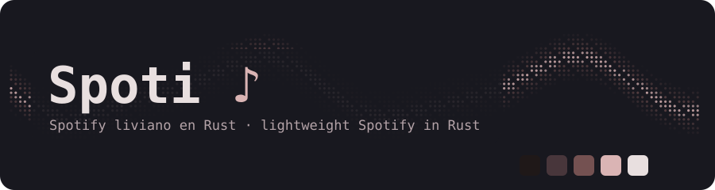
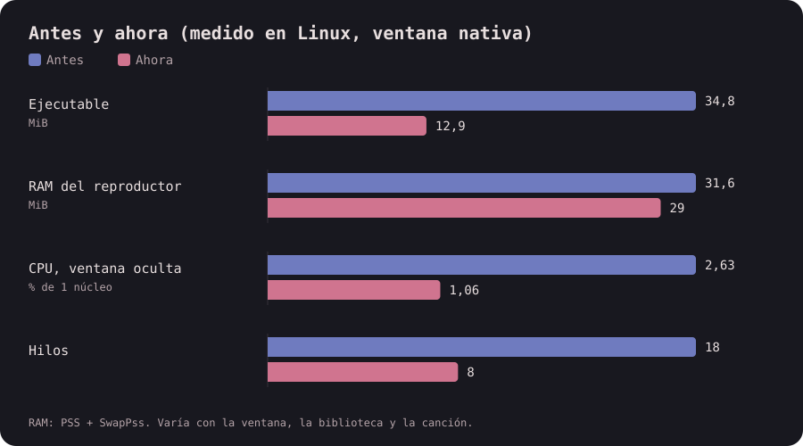

<div align="center">

[English](README.en.md) | **Español**



**Un cliente de Spotify liviano, en Rust, con letras sincronizadas y fondo animado.**


</div>

## Qué es

Spoti es un cliente de Spotify liviano hecho en Rust. Parte de un fork de [ncspot](https://github.com/hrkfdn/ncspot) 1.5.1 y usa [librespot](https://github.com/librespot-org/librespot) para reproducir. **Necesitás una cuenta Spotify Premium.**

## Características

- 🪟 **Ventana nativa en Wayland**, dibujada con Cairo y memoria compartida: sin terminal y sin GTK.
- 🎤 **Letras sincronizadas** desde [LRCLIB](https://lrclib.net), con `Shift+L`. En ventanas angostas, muestra las letras a pantalla completa.
- 🌌 **Fondo animado** de caracteres braille Unicode (se activa o desactiva con `v`).
- 🎨 **Paleta Athena**, leída en vivo desde la sección `[theme]` del `config.toml` de ncspot.
- 🖱️ **El foco sigue al mouse** entre paneles; controles y barra de progreso clickeables.
- 💻 **X11 o terminal**: los mismos paneles dentro de una terminal con `ncspot --panels`.
- 🪟 **Windows**: corre en Windows Terminal con los mismos paneles de letras y fondo (no hay ventana nativa; el foco por hover puede no andar en terminales, el click sí).
- 🧩 **Popover Athena** opcional para Hyprland (`spoti-popover`, con wlr-layer-shell).

## Métricas

<div align="center">

</div>

| Medición | Antes | Ahora |
|---|---|---|
| Ejecutable | 34,8 MiB | 12,9 MiB |
| RAM del reproductor (PSS+SwapPss) | ~31,6 MiB | ~29 MiB (+3–4 MiB con el popover Athena) |
| CPU con la ventana oculta | 2,63 % de un núcleo | 1,06 % |
| Hilos | 18 | 8 |
| Allocations por cuadro de letras | 62 | 0 |

Reproduciendo: ~0,7 % de un núcleo. En pausa: ~0,15 %. Se mantienen **320 kbps** y **gapless**.

> Medido en una sola máquina Linux con la ventana nativa. En Windows no se midió. Los valores varían según el tamaño de la ventana, la biblioteca y la canción.

## Descarga e instalación

Necesitás **Spotify Premium**. Todas las versiones están en [Releases](https://github.com/nicolaschiabrandozanotti/Spotan/releases).

### Linux (x86_64) — un comando

```sh
curl -fsSL https://github.com/nicolaschiabrandozanotti/Spotan/releases/latest/download/spoti-linux-x86_64.tar.gz | tar xz && ./spoti-linux-x86_64/install.sh
```

Después abrilo con `spoti` o desde el menú de aplicaciones. La instalación es por usuario, **sin sudo**: copia todo a `~/.local`, agrega una entrada de escritorio e instala la fuente JetBrains Mono Nerd Font. Probado en Ubuntu 22.04/24.04, Debian 12, Fedora y Arch (glibc ≥ 2.34). Solo necesita PulseAudio o PipeWire, cairo y xkbcommon, que vienen con cualquier escritorio. Para desinstalar: `./spoti-linux-x86_64/uninstall.sh`.

### Windows 10/11 (x64) — un comando en PowerShell

```powershell
irm https://github.com/nicolaschiabrandozanotti/Spotan/releases/latest/download/spoti-windows-x86_64.zip -OutFile "$env:TEMP\spoti.zip"; Expand-Archive "$env:TEMP\spoti.zip" "$env:LOCALAPPDATA\Spoti" -Force; & "$env:LOCALAPPDATA\Spoti\spoti-windows-x86_64\spoti.bat"
```

Para volver a abrirlo: `%LOCALAPPDATA%\Spoti\spoti-windows-x86_64\spoti.bat`. También podés bajar el `.zip` desde Releases, descomprimirlo y hacer doble clic en `spoti.bat`; en ese caso SmartScreen puede avisar porque el ejecutable no está firmado (*Más información → Ejecutar de todas formas*). La primera vez copia el tema a `%APPDATA%\ncspot\config.toml` sin pisar una config existente y abre Windows Terminal si lo tenés.

La primera vez, Spoti te pide iniciar sesión en Spotify desde el navegador.

## Atajos

Son los atajos por defecto de ncspot, más los de Spoti.

| Tecla | Acción |
|---|---|
| `Shift+L` | Letras |
| `Space` / `p` | Pausa / reanudar |
| `n` / `b` | Siguiente / anterior |
| `←` / `→` | Retroceder / avanzar 5 s |
| `+` / `-` | Volumen |
| `↑` / `↓` o `j` / `k` | Desplazar las letras |
| `f` | Seguir la canción actual |
| `[` / `]` | Ajustar el desfase de letras (250 ms) |
| `v` | Fondo braille |
| `q` / `Esc` | Cerrar letras / salir |
| `?` | Ayuda |

## Compilar desde el código

```sh
packaging/build.sh
```

Necesita Docker. Compila Linux en Debian 12 (para tener una glibc vieja) y Windows con compilación cruzada mediante mingw-w64. Los resultados quedan en `dist/`.

Features de Cargo en `ncspot/`:

- `native`: ventana Wayland (implica `panels`).
- `panels`: letras y fondo dentro de cualquier terminal.

El build de Windows usa `--no-default-features --features panels,rodio_backend,crossterm_backend`.

Para publicar una versión: `git tag v0.1.0 && git push origin v0.1.0`. El workflow `.github/workflows/release.yml` compila y sube los dos paquetes a Releases.

La bitácora técnica del desarrollo está en [docs/NOTAS-TECNICAS.md](docs/NOTAS-TECNICAS.md).

## Agradecimientos

Spoti existe gracias a trabajo ajeno:

- **[ncspot](https://github.com/hrkfdn/ncspot)**, de Henrik Friedrichsen y colaboradores: la base de la que partió este proyecto.
- [librespot](https://github.com/librespot-org/librespot): el motor de reproducción.
- [cursive](https://github.com/gyscos/cursive) y [ratatui](https://ratatui.rs): interfaz de terminal.
- [Smithay Client Toolkit](https://github.com/Smithay/client-toolkit): cliente Wayland.
- [LRCLIB](https://lrclib.net): letras sincronizadas.
- [JetBrains Mono](https://www.jetbrains.com/lp/mono/) y [Nerd Fonts](https://www.nerdfonts.com) (OFL / MIT).

Spotify es una marca registrada de Spotify AB. Este proyecto no está afiliado a Spotify.

## Licencia

El código propio de Spoti es MIT (ver [LICENSE](LICENSE)). El fork de ncspot en `ncspot/` sigue bajo BSD-2-Clause ([ncspot/LICENSE](ncspot/LICENSE)). Las fuentes incluidas conservan sus licencias (`packaging/fonts`).
